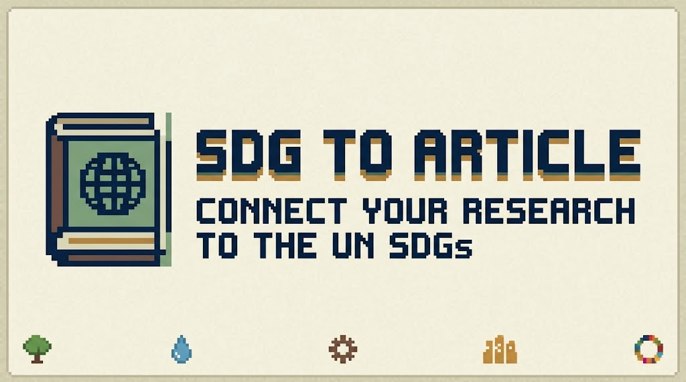

<p align="center">
  
</p>

<h1 align="center">sdg-to-article-skill</h1>

<p align="center">
  <a href="CHANGELOG.md"></a>
  <a href="LICENSE"></a>
  <a href="https://www.python.org/"></a>
  <a href="https://sdgs.un.org/goals"></a>
  <a href="#install"></a>
</p>

<p align="center">
  Connect your research article, thesis, or project to the UN Sustainable Development Goals<br>
  with verified keywords, precise sentences, and ready-to-paste references.
</p>

---

## What this does

You give your AI assistant a draft manuscript, a project folder, or just a description
of your research. It reads the work, identifies which 2 SDGs your contribution genuinely
advances, selects official keywords, drafts the SDG statement at the depth you choose,
validates every keyword against the master list, and returns the text ready to paste —
along with the bibliography entries.

**It never edits your manuscript.** You paste the text yourself.

### Example output (Minimal level)

*Given: a paper on optimising embedded sensor networks for smart building energy control*

> **Introduction (paste near the end):**
> This study directly supports Sustainable Development Goal 9 (Industry, Innovation and
> Infrastructure) through {manufacturing innovation} and {resilient infrastructure}, and
> contributes to Goal 12 (Responsible Consumption and Production) by advancing {resource
> efficiency} in built-environment systems (United Nations, 2015; UN DESA, 2026).

> **Conclusion (paste in closing paragraph):**
> The demonstrated energy savings advance SDG 9's {industrial diversification} agenda
> while reducing operational waste in line with SDG 12's emphasis on {sustainable supply
> chain} management (UN DESA, 2026).

Keywords validated: `{manufacturing innovation}` ✓ `{resilient infrastructure}` ✓
`{resource efficiency}` ✓ `{sustainable supply chain}` ✓ — all on the official INTI list.

---

## Three insertion levels

Choose when you ask, or the AI will suggest based on your manuscript type.

| Level | What you get | Best for |
|---|---|---|
| **Minimal** | 2–3 sentences: 1 in Introduction, 1 in Conclusion | Conference papers, short articles |
| **Complete** | Minimal sentences + a dedicated 3–5 sentence passage | Journal papers, theses, reviews |
| **Custom** | You control depth, placement, goals, keywords | Any specific requirement |

---

## Who is this for

Anyone who wants to explicitly connect their research output to the UN 2030 Agenda — for
journal submission, institutional compliance, portfolio impact, or just good practice.

The keyword data originates from INTI International University's official SDG keyword list
(17 goals, 1,634 terms). It is structured and validated, making it useful for any researcher
regardless of institution.

---

## Install

### Option 1 — Use SKILL.md directly (no install needed)

`SKILL.md` at the root of this repo is a plain instruction file. Paste its contents into
your AI tool's system prompt, or drop it into your project as `SKILL.md` / `CLAUDE.md`.

### Option 2 — Install into your AI tool's skill directory

```bash
git clone https://github.com/nyan-dev/sdg-to-article-skill
cd sdg-to-article-skill
./install.sh
```

Installs into all detected tool directories:
- **opencode** → `~/.config/opencode/skills/sdg-to-article/`
- **Antigravity (AGY)** → `~/.config/antigravity/skills/sdg-to-article/`
- **Claude Code** → `~/.claude/skills/sdg-to-article/`

Use `./install.sh --copy` if the repo lives on a different filesystem (e.g. Windows/WSL boundary).

**No dependencies.** Python 3 standard library only. No network access at runtime.

---

## Use

Just ask — in any project folder:

> Add SDG statements to my manuscript

> Which SDG goals does this paper contribute to?

> Check if my SDG keywords are valid

> Add Complete-level SDG content to this thesis draft

---

## What the skill enforces

| Rule | Detail |
|---|---|
| Verified keywords only | Every keyword checked against the official INTI list before text is returned |
| Clean keywords | `{food security}` not `{fertili?er}` — stem-form and encoding artefacts are avoided in drafted text |
| Curly braces | All keywords written `{keyword}` in drafts |
| Honest framing | Goals selected based on what the paper demonstrably contributes, not what sounds impressive |
| Citation included | `(UN DESA, 2026)` and/or `(United Nations General Assembly, 2015)` always attached |
| Non-destructive | Manuscript is never modified; text is returned for the author to place |

---

## Data formats

| File | Format | What it is |
|---|---|---|
| `skill/sdg-to-article-skill/resources/sdg_keywords.csv` | CSV | Canonical flat table, 1,634 rows. Source of truth. |
| `skill/sdg-to-article-skill/resources/sdg_keywords.md` | Markdown | Grouped by goal. Best for reading. |
| `skill/sdg-to-article-skill/resources/sdg_keywords.json` | JSON | Consumed by the validator. |
| `skill/sdg-to-article-skill/resources/sdg_targets.md` | Markdown | 169 official UN sub-targets. |
| `skill/sdg-to-article-skill/resources/citations.md` | Markdown | Ready-to-paste bibliography entries. |

---

## Repo layout

```
sdg-to-article-skill/
├── SKILL.md                            ← Root-level skill file (universal — any AI tool)
├── README.md
├── INTENT.md                           ← Author's design rationale
├── CHANGELOG.md
├── install.sh                          ← Installs into opencode / AGY / Claude Code
└── skill/sdg-to-article-skill/
    ├── SKILL.md                        ← Same content + YAML frontmatter for tool discovery
    ├── resources/
    │   ├── sdg_keywords.csv            ← Canonical source of truth
    │   ├── sdg_keywords.md             ← Human/LLM readable
    │   ├── sdg_keywords.json           ← Validator input
    │   ├── sdg_targets.md              ← UN sub-targets (2.4, 12.3, 14.2 …)
    │   └── citations.md                ← Reference entries
    └── scripts/
        ├── check_sdg.py                ← Keyword validator
        ├── build_resources.py          ← Rebuilds md + json from CSV
        └── import_sdg_source.py        ← Import a new INTI keyword .docx
```

---

## Updating the keyword list

The CSV is the source of truth. To update when INTI publishes a new keyword revision:

```bash
pip install python-docx
python3 skill/sdg-to-article-skill/scripts/import_sdg_source.py "/path/to/new-list.docx"
python3 skill/sdg-to-article-skill/scripts/build_resources.py
```

> **Planned for a future version:** Support for CSV and plain-text keyword source formats
> in addition to `.docx`. Currently, `.docx` only.

The previous CSV is backed up to `sdg_keywords.csv.bak` before overwriting.
After importing, delete the `.docx` — nothing else needs it.

---

## Citations used

> United Nations Department of Economic and Social Affairs. (2026). *The Sustainable
> Development Goals Report 2026*. United Nations, New York, NY.
> https://unstats.un.org/sdgs/report/2026/

> United Nations General Assembly. (2015). *Transforming our world: the 2030 Agenda for
> Sustainable Development* (Resolution A/RES/70/1). United Nations, New York, NY.
> https://undocs.org/A/RES/70/1

Full metadata and usage notes in `skill/sdg-to-article-skill/resources/citations.md`.

---

## A note on curly braces

INTI stores Goals 1–12 keywords as `{keyword}` and Goals 13–17 as `(keyword)`. This skill
normalises everything to curly braces for consistency. If you are submitting to INTI's
compliance checker and your paper claims Goals 13–17, the skill will flag this and offer
both forms. Goals 1–12 are unaffected.

---

## Validator (standalone use)

```bash
# Check a drafted sentence directly
python3 skill/sdg-to-article-skill/scripts/check_sdg.py \
  "This work advances {resilient infrastructure} and {resource efficiency}." \
  --min-goals 2

# Scan a finished .docx for existing INTI keywords
python3 skill/sdg-to-article-skill/scripts/check_sdg.py path/to/manuscript.docx
```

Exit codes: `0` all valid · `1` unknown keyword found · `2` no `{curly}` keywords found

---

## About

Built with 💖 and opencode/claude/agy by @nyan-dev, a postgraduate research student at INTI International University.
where published papers are encouraged to demonstrate contribution to the UN SDGs using keywords from INTI's official list. The original problem was a 1,634-keyword `.docx` that no AI tool could read
reliably. This skill solves that — and is useful for anyone wanting to connect their work to the global sustainability agenda.

**Keyword data:** INTI International University — revision 06 June 2025 · 17 goals · 1,634 terms  
**Maintained by:** [@nyan-dev](https://github.com/nyan-dev)
